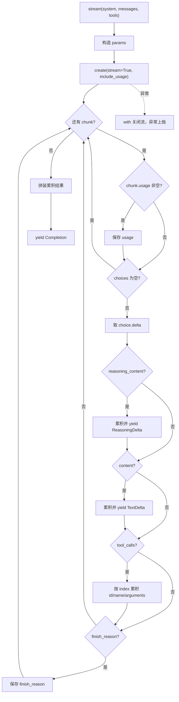
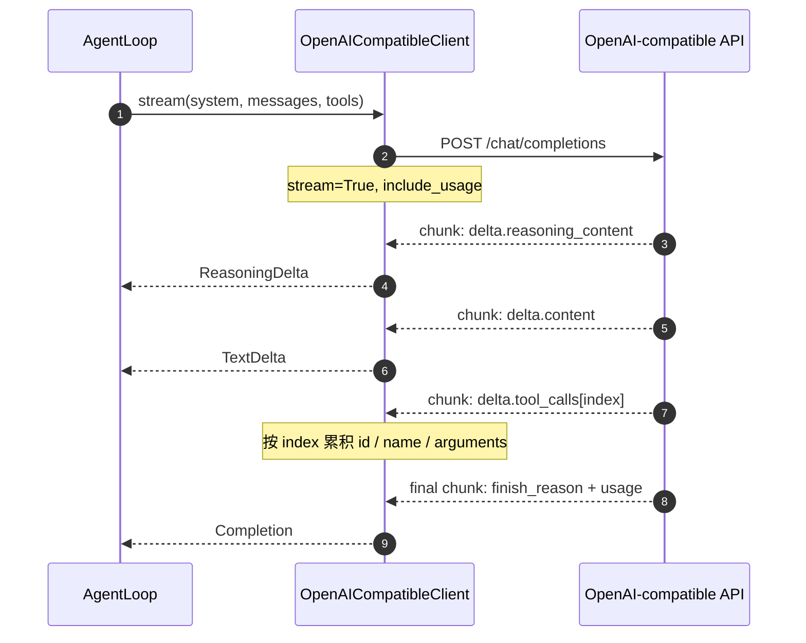

# llm.py 技术方案（最小版）

> v0.1 子设计，对应 [v0.1.md](v0.1.md) 的模块划分与事件模型。目标：一个约 100 行、只依赖 `openai` 的文件，把一次 OpenAI 兼容流式调用变成类型化的 chunk 序列。

## 1. 职责边界

**做**：构造请求、解析 SDK chunk、拼装 text / reasoning / tool_calls、提取 usage、产出终态 `Completion`。

**不做**：重试、错误包装、落盘、发事件、执行工具、处理中断、序列化消息、读环境变量。这些分别归 loop、session、cli。

本文件是核心：只认 OpenAI Chat Completions 形状，代码里不出现厂商名。厂商差异（默认 model / base_url、是否回传 `reasoning_content`、请求附加参数）在 `providers.py` 的 `ProviderProfile`；`echo_reasoning` 的分支在 session，不在这里。

## 2. 接口

```python
@dataclass(frozen=True)
class ToolCall:
    id: str
    name: str
    arguments: str  # 原始 JSON 文本，不解析

@dataclass(frozen=True)
class Usage:
    prompt_tokens: int
    completion_tokens: int
    cache_hit_tokens: int
    cache_miss_tokens: int
    reasoning_tokens: int

@dataclass(frozen=True)
class ReasoningDelta:
    text: str

@dataclass(frozen=True)
class TextDelta:
    text: str

@dataclass(frozen=True)
class Completion:
    content: str
    reasoning_content: str
    tool_calls: tuple[ToolCall, ...]
    finish_reason: str | None
    usage: Usage

Chunk = ReasoningDelta | TextDelta | Completion

class ChatClient(Protocol):
    def stream(
        self,
        *,
        system: str,
        messages: Sequence[dict[str, object]],
        tools: Sequence[dict[str, object]] = (),
    ) -> Iterator[Chunk]: ...

class OpenAICompatibleClient:
    def __init__(self, *, model: str, base_url: str, api_key: str) -> None: ...
    def stream(...) -> Iterator[Chunk]: ...
```

三个形状决定：

- `system` 是独立参数，不放进 `messages`。system prompt 不属于会话历史，session 不应该有机会把它存成 entry。
- `messages` / `tools` 是 OpenAI 形状的 dict，原样透传，不排序、不裁剪、不注入。前缀缓存依赖字节稳定。
- `ToolCall.arguments` 是原始字符串。解析和失败处理归 loop / 工具层，`llm.py` 不修复 JSON。

## 3. 请求构造

```
model       = 构造参数
messages    = [{"role": "system", "content": system}, *messages]
tools       = 非空才带，空则整个 key 省略
stream      = True
stream_options = {"include_usage": True}
```

不发 `temperature` / `presence_penalty` / `frequency_penalty` / `tool_choice` / `reasoning_effort`。前四个在 thinking 模式下被忽略或不支持；`reasoning_effort` 默认就是 `high`，最小版不显式固定。

`base_url` 必须是字符串。SDK 在 `None` 时会回落到 `OPENAI_BASE_URL` 环境变量，等于让 `llm.py` 偷偷读 env。

## 4. 处理流程




## 5. 时序



`Completion` 之后的两步不在这张图里：loop 执行 `tool_calls` 并写 session；下一 step 再次调用 `stream(...)`，messages 里的 assistant 消息原样带回 `reasoning_content`（仅当 profile 的 `echo_reasoning` 为真）。

`llm.py` 不知道 session、事件和工具执行。它只保证：一条流结束时恰好产出一个 `Completion`，且其中的 `tool_calls` 已经拼装完整。

## 6. 四个协议坑

| 坑 | 处理 |
| --- | --- |
| `reasoning_content`（DeepSeek 扩展）在 SDK 类型里不存在 | 用 `getattr(delta, "reasoning_content", None)` 读取，累积后放进 `Completion.reasoning_content`；其它 provider 没有该字段时自然为空 |
| 工具调用参数分片到达 | 以 `index` 为键累积；`function` 可能为 `None`，`id` / `name` 取首个非空，`arguments` 字符串拼接 |
| usage 没有独立的 chunk | 每个 chunk 都检查 `usage`，非空就覆盖；空 `choices` 也要先读 usage 再跳过 |
| `finish_reason="length"` 时参数可能被截断 | 原样报告，不解析、不执行；由 loop 决定补 `is_error` 还是收尾 |

`include_usage` 必须显式传：官方文档说没有独立的 usage-only chunk，但流式 usage 仍需要这个参数才会返回。

## 7. 明确推迟

| 项 | 现状 | 何时补 |
| --- | --- | --- |
| 重试 / 退避 | 不写，用 SDK 默认（2 次） | 需要控制重试边界时 |
| 错误包装 | 不写，SDK 异常直接上抛 | loop 需要 `status_code` 时 |
| usage 缺失语义 | 先记 0 | 需要区分"未上报"时 |
| 中断处理 | 不写，`with` 负责关闭流 | 已在 loop 处理 partial |
| `length` 配对 | 只报告 | loop 实现工具回灌时 |
| 测试 / faux provider | 不写 | 接口稳定后 |
| 流式事件映射 | 不写 | loop 接入时 |

## 8. 验收

- `ruff` / `mypy` 通过，导入不依赖环境变量。
- 真实调用一次：打印正文、一个工具调用、usage；再发第二轮带 tools 的请求，确认 `reasoning_content` 回传不 400。
- 文件控制在约 100 行，不出现事件、session、工具执行相关代码。

有一条验收不归本文件：`MARS_PROVIDER=openai` 下确认 assistant 消息不带 `reasoning_content` 且请求不被拒。`echo_reasoning` 的分支在 session，provider 解析在 cli，`llm.py` 单独无法验证，归入 providers / session 批次。
